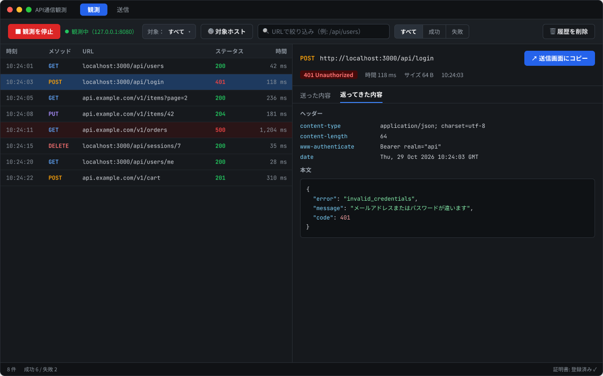
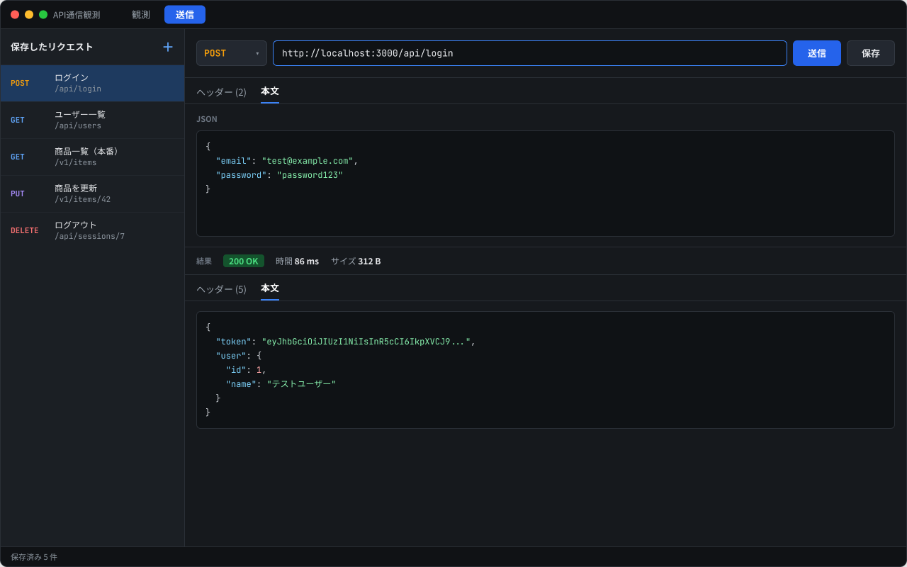
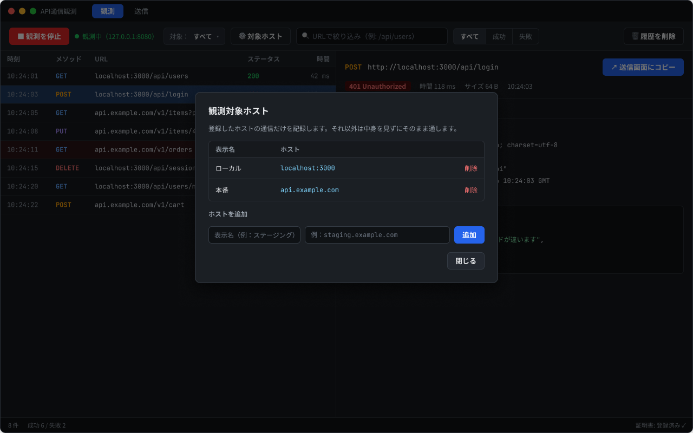
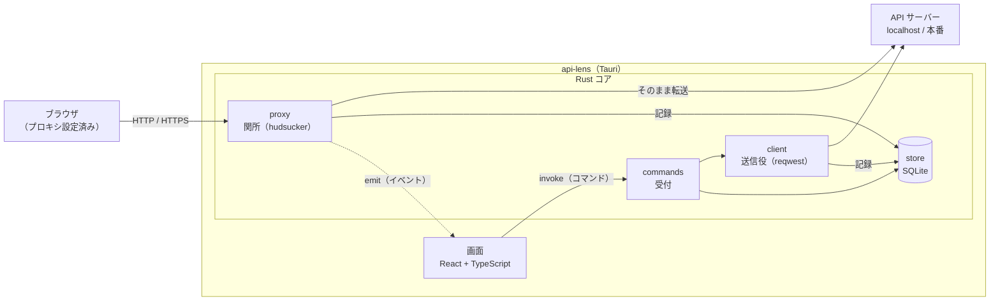
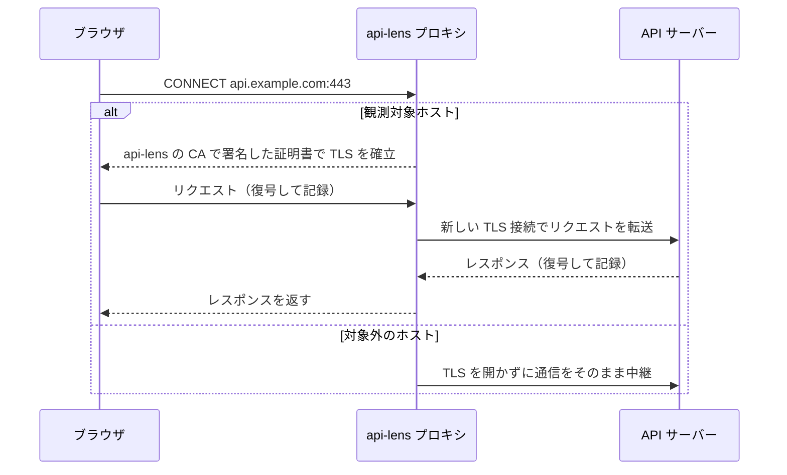
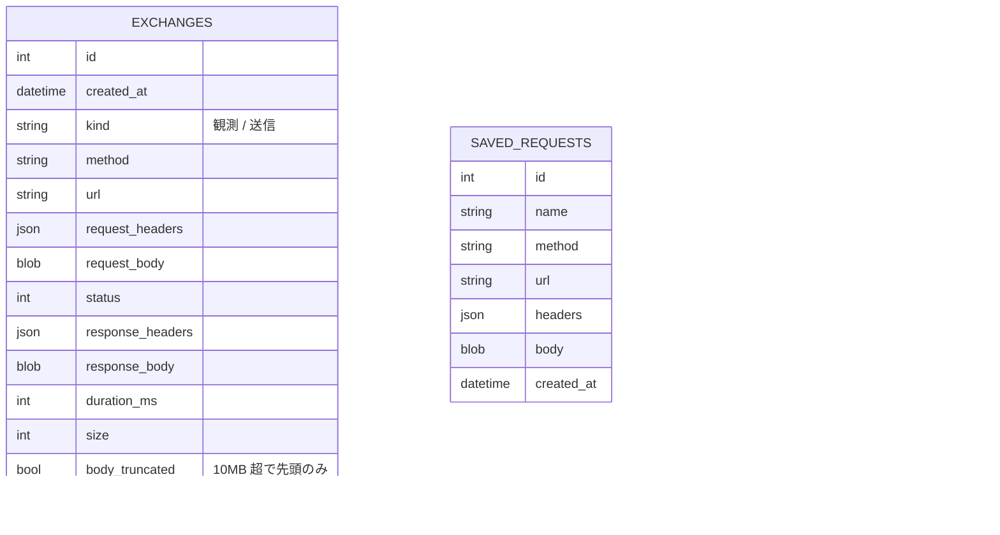

<div align="center">

# 🔍 api-lens

**自分のアプリの API 通信を、送って・見て・直して・また送る。**

ローカルで完結する、Web アプリ開発者のための API クライアント＋通信観測デスクトップアプリ


-orange)




*観測画面（イメージ画像）*

</div>

> [!NOTE]
> 個人の学習を兼ねて開発中のプロジェクトです。現在は **P0（準備・土台）** の段階で、以下で紹介している機能はまだ実装されていません。画像は Figma で作ったデザイン案です。

## 目次

- [なぜ作るのか](#なぜ作るのか)
- [特徴](#特徴)
- [スクリーンショット](#スクリーンショット)
- [技術スタック](#技術スタック)
- [アーキテクチャ](#アーキテクチャ)
- [HTTPS 観測のしくみ](#https-観測のしくみ)
- [データ設計](#データ設計)
- [はじめかた](#はじめかた)
- [使いかた](#使いかた)
- [ディレクトリ構成](#ディレクトリ構成)
- [ロードマップ](#ロードマップ)
- [セキュリティ](#セキュリティ)
- [スコープ外](#スコープ外)
- [ドキュメント](#ドキュメント)
- [ライセンス](#ライセンス)

## なぜ作るのか

Web アプリを開発していると、こんな場面がよくあります。

- 動作確認のたびに、同じリクエストを curl や API クライアントで作り直している
- ブラウザの DevTools では、ページを移動したりタブを閉じたりすると通信ログが消えてしまう
- 本番環境で起きた 401 や 500 の通信を手元で再現したいのに、ヘッダーや本文を手で書き写している

api-lens は、**API クライアント**と**通信観測（ローカルプロキシ）** を 1 つのアプリにまとめて、「通信を実行する → 観測する → 原因を調べる → 直して送り直す」までをひと続きで行えるようにすることを目指しています。

## 特徴

### 📤 送信モード（API クライアント）

- GET / POST / PUT / PATCH / DELETE に対応し、URL・ヘッダー・JSON 本文を自由に組み立てて送信
- リクエストは Rust 側（reqwest）から送るので、ブラウザの CORS 制約を受けない
- ステータスコードを色分け（成功は緑・失敗は赤）し、レスポンスヘッダー、整形済みの JSON、かかった時間、サイズを表示
- リクエストに名前を付けて SQLite に保存し、再起動後も一覧から呼び出して再送できる
- 認証はヘッダーを手で入力（`Authorization: Bearer ...`）

### 🔭 観測モード（ローカルプロキシ）

- 「観測開始」でアプリが `127.0.0.1` 上にプロキシを立ち上げ、プロキシを通したブラウザの通信を記録
- DevTools の Network タブのように、時刻・メソッド・URL・ステータス・時間をリアルタイムに一覧表示（通信が起きてから 1 秒以内に反映）
- **HTTPS の中身も見られる**。アプリが自分専用の CA 証明書を作り、TLS をプロキシで終端する
- **観測対象ホストだけを記録**（例：`localhost:3000`、`api.example.com`）。それ以外の通信は TLS を開かずにそのまま通す
- URL・成功 / 失敗・ホストで絞り込み
- 観測した通信を **ワンクリックで送信画面にコピー**し、少し直して送り直せる
- 履歴は SQLite に保存（最新 1,000 件まで。古いものから自動で削除）

## スクリーンショット

| 観測画面（イメージ画像） | 送信画面（イメージ画像） |
| :---: | :---: |
|  |  |

<details>
<summary>対象ホスト設定ダイアログ（イメージ画像）</summary>



*対象ホスト設定ダイアログ（イメージ画像）*

</details>

## 技術スタック

| レイヤー | 技術 | 選んだ理由 |
| --- | --- | --- |
| デスクトップ | [Tauri 2](https://tauri.app/) | 画面は慣れた Web 技術で作り、学習の中心を Rust 側（送信・プロキシ・保存）に集中できる。Electron より配布サイズが小さい |
| フロントエンド | React 19 + TypeScript + Vite | Tauri の中では Next.js のサーバー機能が使えないため、軽い Vite + React を採用 |
| HTTP クライアント | [reqwest](https://docs.rs/reqwest) | ネイティブ側から送ることで、CORS・Cookie・ヘッダーの制限を受けない |
| プロキシ | [hudsucker](https://docs.rs/hudsucker) | HTTP/HTTPS の MITM プロキシを組み立てられる Rust のライブラリ。CA を使った証明書の動的生成に対応 |
| 永続化 | SQLite（[rusqlite](https://docs.rs/rusqlite)） | 単一ファイルで完結し、サーバー不要でローカルに閉じられる |
| 非同期ランタイム | [tokio](https://tokio.rs/) | プロキシの待ち受けと UI からのコマンド処理を並行して動かす |

## アーキテクチャ



### 画面と Rust のやり取り

| 方向 | Tauri の仕組み | 使いどころ |
| --- | --- | --- |
| 画面 → Rust | **コマンド**（`invoke`） | 送信、保存、観測開始 / 停止、ホストの登録・削除、履歴の読み込み |
| Rust → 画面 | **イベント**（`emit` / `listen`） | プロキシが通信を 1 件記録するたびに「新しい通信」を通知し、一覧に 1 行追加 |

### 責務の分け方

- 画面とやり取りするのは `commands` だけ。`client`・`proxy`・`store` は Tauri や画面のことを知らない
- 画面側も `src/api/` に `invoke` とイベント受信をまとめ、コンポーネントから Tauri の API を直接呼ばない
- データの形は Rust の `models/` と TypeScript の `types/` で対応させ、serde でシリアライズしてやり取りする

### 処理の流れ

<details>
<summary>観測モード</summary>

1. 画面で「観測開始」を押すと、コマンド経由で `proxy` が `127.0.0.1` で待ち受けを始める
2. ブラウザで自分のアプリを操作すると、ブラウザはプロキシ設定に従って通信をプロキシに渡す
3. 宛先が観測対象ホストなら、プロキシが中身を記録して本来の API サーバーへ転送する。対象外なら中身を開かずにそのまま通す
4. API サーバーの返事もプロキシを通り、記録されてからブラウザへ戻る
5. 記録した通信を `store` に保存し、イベントで画面に通知して一覧に 1 行増やす

</details>

<details>
<summary>送信モード</summary>

1. 画面で URL・メソッド・ヘッダー・本文を入力して「送信」を押す
2. 画面がコマンドで `client` に送信を頼む
3. `client`（reqwest）が API サーバーへ送り、ステータス・ヘッダー・本文・時間・サイズを受け取る
4. 結果を `store` に保存し、コマンドの戻り値として画面に返す

</details>

## HTTPS 観測のしくみ

本番環境は HTTPS が前提なので、暗号化された中身を見るために **MITM（中間者）プロキシ** の仕組みを使います。



- 初回起動時に、hudsucker で**このアプリ専用の CA 証明書**を作ります
- 観測対象ホストへの接続のときだけ、その CA で署名したホスト用の証明書をその場で作り、ブラウザとの TLS をプロキシで終端します
- ブラウザがこの証明書を信頼するには、CA を macOS のキーチェーンに登録する必要があります。**登録はアプリが手順を表示し、ユーザーが手作業で行います**（アプリが勝手に登録することはありません）
- 証明書ピンニングをしているアプリは、この仕組みでは観測できません

## データ設計

SQLite に 3 つのテーブルを作ります。ヘッダーは名前と値のペアを JSON 文字列にして 1 列に保存します。



> カラム名は説明のための仮の名前です。型やインデックスなどの物理設計は実装時に決めます。

| 項目 | 方針 |
| --- | --- |
| 履歴の上限 | 通信の記録は最新 1,000 件まで。超えたら古いものから自動で削除 |
| 大きなレスポンス | 本文が 10MB を超えたら先頭だけを表示し、サイズを知らせる |
| 反映の速さ | 通信が起きてから 1 秒以内に一覧に出す |

## はじめかた

### 必要なもの

- macOS
- [Node.js](https://nodejs.org/)（npm）
- [Rust](https://www.rust-lang.org/tools/install)（stable）
- Xcode Command Line Tools（詳しくは [Tauri の前提条件](https://tauri.app/start/prerequisites/)）

### 起動

```bash
git clone https://github.com/koume21/api-lens.git
cd api-lens
npm install
npm run tauri dev
```

### コマンド一覧

| コマンド | 内容 |
| --- | --- |
| `npm run tauri dev` | 開発モードで起動（Vite の開発サーバー `localhost:1420` も自動で起動） |
| `npm run tauri build` | 配布用のアプリをビルド |
| `npm run build` | TypeScript の型チェックとフロントエンドのビルド |
| `cargo check` / `cargo clippy` / `cargo test` | Rust 側のチェック・静的解析・テスト（`src-tauri/` で実行） |

## 使いかた

> 観測モードは P5 で実装する予定です。以下は予定している使いかたです。

1. **観測対象ホストを登録する**：観測画面の「⚙ 対象ホスト」から、`localhost:3000` や本番のドメインを表示名付きで登録します
2. **CA 証明書を信頼する**（HTTPS を観測する場合のみ）：アプリに表示される手順に従って、CA 証明書を macOS のキーチェーンに登録します
3. **ブラウザのプロキシを設定する**：ブラウザ（または macOS のネットワーク設定）で、HTTP / HTTPS プロキシを `127.0.0.1:8080` に向けます
   - 例：Chrome を観測用に別プロファイルで起動する
     ```bash
     open -na "Google Chrome" --args --user-data-dir=/tmp/api-lens-chrome --proxy-server="127.0.0.1:8080"
     ```
4. **観測を開始する**：「観測開始」を押して、ブラウザで自分のアプリを操作します
5. **気になる通信を送り直す**：一覧から通信を選び、「↗ 送信画面にコピー」で送信画面に移して、直して送り直します

## ディレクトリ構成

```txt
api-lens/
├─ src/                    # 画面（React / TypeScript）
│  ├─ pages/               # 観測画面・送信画面
│  ├─ components/          # 一覧、詳細、リクエスト入力、結果表示、ホスト設定など
│  ├─ api/                 # Rust を呼ぶ窓口（invoke・イベント受信）
│  └─ types/               # データの形（Rust の models と対応）
├─ src-tauri/              # Rust 側
│  ├─ src/
│  │  ├─ main.rs           # 起動するだけ
│  │  ├─ lib.rs            # Tauri の準備とコマンドの登録
│  │  ├─ commands/         # 画面からの依頼を受ける受付
│  │  ├─ client/           # 送信役（reqwest）
│  │  ├─ proxy/            # 関所（hudsucker・証明書）
│  │  ├─ store/            # 保存係（SQLite）
│  │  └─ models/           # データの形
│  ├─ capabilities/        # Tauri の権限設定
│  └─ tauri.conf.json
└─ docs/                   # 要件定義・設計ドキュメント
```

> 現在はテンプレートに近い状態です。フォルダは各フェーズで必要になった時点で追加していきます。

## ロードマップ

API クライアントを先に完成させ、その上に保存・環境・テスト・観測を積み上げていきます。

- [ ] **P0 準備・土台**：ボタンを押すと固定の API のレスポンスが画面に出る
- [ ] **P1 API クライアント MVP**：GET / POST / 認証付きリクエスト、エラーとタイムアウトの扱い
- [ ] **P2 保存と実用性**：SQLite の導入、リクエストの保存と再送、実行履歴
- [ ] **P3 環境変数・認証・秘密情報**：環境の切り替え、トークンの安全な保管
- [ ] **P4 API テスト・シナリオ実行**：アサーション、ログイン → データ取得のシナリオ
- [ ] **P5 通信観測**：ローカルプロキシ、HTTPS の観測、観測対象ホストの絞り込み
- [ ] **P6 統合・品質向上・公開**：観測した通信からテストを作る、Windows での動作確認

## セキュリティ

- 観測した通信は **PC の中（SQLite）だけ**に保存し、外部へは送りません
- プロキシは `127.0.0.1` だけで待ち受け、ほかの PC からは使えないようにします
- CA 証明書の秘密鍵は PC の外に出しません。漏れると、偽のサイトを本物に見せかけられてしまいます。リポジトリにもコミットしません
- 観測データには Cookie やトークンが含まれることがあります。ログには出さず、表示や保存のときにマスキングできるようにする予定です
- 観測するのは、**自分が管理するアプリや許可されたテスト環境に限ってください**

## スコープ外

あえてやらないこと：

- 他のアプリの通信を自動で検出・傍受すること
- 通信の書き換え・遮断（観測は見るだけ）
- HTTP/2・HTTP/3・QUIC・WebSocket への対応
- 証明書ピンニングの回避
- チームでの共有やクラウド同期

## ドキュメント

要件定義から設計までの詳細は [`docs/`](docs/README.md) にまとめています。

| ドキュメント | 内容 |
| --- | --- |
| [概要とスコープ](docs/01-overview-and-scope.md) | コンセプト、解決したい課題、スコープ |
| [要件定義](docs/04-requirements.md) | ユースケース、機能要件 F1〜F22、非機能要件 N1〜N6 |
| [設計](docs/05-design.md) | 構成、処理の流れ、DB、画面、フォルダ構成 |
| [開発フロー](docs/06-phases.md) | フェーズ P0〜P6 の目的と完了の目安 |

## ライセンス

[MIT License](LICENSE) © 2026 koumei
